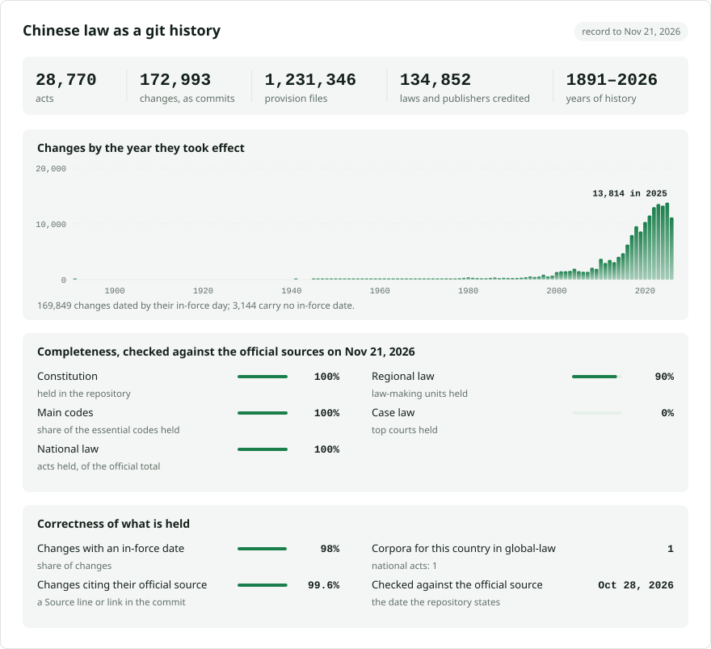

# China: law history in git

[简体中文](README.md) · **English**

<picture>
<source media="(prefers-color-scheme: dark)" srcset="data/effort-dark.svg">

</picture>

The law of China as a git history: one file per article, one commit per version on the day it took effect, and the act that made each change as the commit's author. `git blame` names the act behind every paragraph; `git log` lists every change to an article; picking a date gives the text in force that day.

Part of [lexifina/global-law](https://github.com/lexifina/global-law), one git history for every country's law: this is China's national law, which global-law reads at `china/national/acts/`.

**What is in it now:** about 172,000 commits (22 November 2026): the Constitution with its five amendments ([`宪法/`](宪法/)); the laws of the National People's Congress and its Standing Committee, in force and repealed, with their versions, the amending and repealing instruments, legislative interpretations and decisions ([`法律/`](法律/), [`修改和废止/`](修改和废止/), [`法律解释/`](法律解释/), [`决定/`](决定/)); administrative and supervision regulations ([`行政法规/`](行政法规/), [`监察法规/`](监察法规/)); departmental rules ([`部门规章/`](部门规章/)); judicial interpretations of the Supreme People's Court and Procuratorate ([`司法解释/`](司法解释/)); the local regulations, government rules, normative documents and gazettes of the provinces, cities and counties ([`地方/`](地方/)); central Party regulations ([`党内法规/`](党内法规/)); State Council and ministry normative documents ([`规范性文件/`](规范性文件/)); the State Council and NPC Standing Committee gazettes ([`公报/`](公报/)); treaties ([`条约/`](条约/)); and official cases ([`案例/`](案例/)). Against the official lists: the Constitution 100%, laws 100% of all versions, administrative regulations 100%, judicial interpretations 100%, departmental rules in force 92%, local regulations 90%, local government rules in force 100%. [`COVERAGE.md`](COVERAGE.md) gives each category's official total, what is here and why the rest is not yet; [`PLAN.md`](PLAN.md) lists every part and how far each one is.

Each law is a folder in [`法律/`](法律/) named by its Chinese title, one file per article (`法律/劳动合同法/第066条.md` is 第六十六条 of the 中华人民共和国劳动合同法, the Labour Contract Law), with `目录.md` for the headings of its parts and chapters and `附件N.md` for its annexes; the Constitution is [`宪法/`](宪法/), its preamble `宪法/序言.md`. Until 20 November 2026 these folders had pinyin names at the top of the repository (`laodonghetongfa/art-066.md`); [`data/paths.json`](data/paths.json) maps every old path to its new one, and `git log --follow` follows each file across the move. Article numbers are those of the version in force: where a change renumbers articles, git shows the text moving between files.

The text is in Chinese, as its official sources publish it. An English translation is not part of this record.

## Questions as git commands

| Question | Command |
| --- | --- |
| Every change to Article 66 of the Labour Contract Law | `git log -p --follow --word-diff -- 法律/劳动合同法/第066条.md` |
| Which act wrote each line of Article 66? | `git blame 法律/劳动合同法/第066条.md` |
| Every version of the Labour Contract Law, with the day each took effect | `git log --format="%h %(trailers:key=In-force,valueonly,separator=) %an" -- 法律/劳动合同法 laodonghetongfa ':!法律/劳动合同法/README.md' ':!laodonghetongfa/README.md'` |
| Article 66 as in force on 1 January 2010 | `python tools/on_date.py 2010-01-01 法律/劳动合同法 66` |

**Outside git**, we also host this record publicly, for free:

- **[Ask Claude about Chinese law](https://global-law.lexifina.com/v1/try_claude?country=china)**: opens Claude with a first question ready.
- **[Ask ChatGPT](https://global-law.lexifina.com/v1/try_chatgpt?country=china)**: the same question in ChatGPT.
- **[Search Chinese law on our site](https://lexifina.com/law?country=china&q=%E5%B9%B4%E4%BC%91%E5%81%87)**: a search for "年休假" (annual leave), with each provision's text and its versions, no account needed.
- **[Developer REST API](https://global-law.lexifina.com/v1/search_law?query=%E5%B9%B4%E4%BC%91%E5%81%87&jurisdiction=china)**: the same search as JSON, with no key. See the [documentation here](https://lexifina.com/api/global-law).

Both assistants read the record through the free Global law connector (MCP, `https://global-law.lexifina.com/mcp`); the first time, the chat gives you the link that adds it. Ask in Chinese or in English.

**Host it yourself easily.** All it takes is git and Python, and the tools run on your machine:

```sh
git clone --depth 1 https://github.com/lexifina/global-law && cd global-law
python3 tools/countries.py add china/national/acts
python3 tools/law.py show 2026-01-01 china/national/acts/laodonghetongfa/art-066.md
```

Opened in Claude Code, Cursor, VS Code or Codex, the clone also starts a local MCP server with the same tools ([MCP.md](https://github.com/lexifina/global-law/blob/main/MCP.md)).

## Dates

Each commit is dated at noon, Asia/Shanghai, on the day the version took effect, and carries it in its `In-force:` trailer; the versions of every law but the Constitution also say where the day comes from, in `In-force-evidence:`:

- for a law as adopted or revised, its own commencement article (本法自……起施行);
- for a version made by an amending decision or a 刑法修正案, the commencement it states (本决定自……起施行, 本修正案自……起施行), often the day it was promulgated (自公布之日起施行); each of the Constitution's five amendments was adopted, promulgated and in force on the same day;
- a correction to the standard text printed in the 全国人大常委会公报 (two, both to the 1997 Criminal Law) carries the day of the version it corrects, and `tools/on_date.py` applies it to that version;
- every other record: the 施行日期 it states (its own commencement clause, or its source's 施行日期), else its 公布日期 or 发布日期; a record that states neither is held, never dated on an estimate. A version found after a later one was published is added as a labelled correction (`Kind: correction`), which `tools/on_date.py` applies to its days.

Each change is credited to the act that made it, as 中国人大网 names it (`中华人民共和国刑法修正案（十一）（2020年）`), at an address that cannot exist (`xingfa-xzan-2020@npc.gov.cn.invalid`). Where the record starts at a law's current consolidated text (45 laws), the whole text is credited to the latest amending act; the oldest texts of the Criminal Procedure Law (1997) and the Company Law (2018), the two corrections and one typographic difference in the Constitution's official 2018 text are credited to the publisher, `中国人大网 (全国人大常委会办公厅)`.

## How it is checked

- `tools/check_repo.py` compares the Constitution's 1982 version and its current text with the official pages, byte for byte and again by the letters and digits an independent extractor reads, and checks that every new wording an amendment quotes is in that version's files. The versions in between have no official consolidated text: they are the amendments applied.
- For every other act, the letters and digits of each source page (目录 and headings taken out) must equal those of the act's files, in order.
- `tools/test_repo.py` checks that `git blame` names an amending act, that `tools/on_date.py` gives the text before and after a known amendment, and that every law commit has an `In-force:` trailer. Two builds of the Constitution from the same pages gave the same head hash; see [`REPRODUCE.md`](REPRODUCE.md).
- History is append-only: no merge commits, the laws were added on top of the Constitution's history, and no published commit is rewritten.
- [vulnerabilities/](vulnerabilities/README.en.md): possible drafting mistakes in this law, found by global-law's detectors and checked by hand. Not run yet.

## What it does not show

- **The rest of each category.** [`COVERAGE.md`](COVERAGE.md) gives the gap in each core category and why: older versions still to be back-filled, records that state no 施行 or 公布 day (held, not estimated), and rules still waiting their turn at a rate-limited source.
- **Court judgments** of 中国裁判文书网 and the 人民法院案例库, and **military regulations**, which are not published as official texts. The National Laws Database (flk.npc.gov.cn) is not fetched, as its robots.txt forbids automated collection: its own Word files and record lists come from third-party mirrors, and each commit names both.

## Sources

| Source | Kind | Past versions | Notes |
| --- | --- | --- | --- |
| [中国人大网](http://www.npc.gov.cn) (全国人大常委会办公厅, General Office of the NPC Standing Committee) | Official site of the NPC: the Constitution and its amendments, laws, amending decisions | partly: laws as adopted or revised and the decisions that amended them; otherwise the current text only | Each version names its page in a `Source:` trailer, and a consolidated text the decision behind it in `Decision:` |
| 全国人大常委会公报 (on 中国人大网) | Gazette of the NPC Standing Committee, as PDF | the text as published | The standard text of a law (立法法); used for the 民法典 and for the 1997 Criminal Law and its amendments to 2021 |
| 国家法律法规数据库 (flk.npc.gov.cn), its Word files via the mirrors lawtext/law-flk-vol1 and law-flk-vol2 | Laws, administrative and supervision regulations, judicial interpretations, local regulations and decisions | every version flk lists | flk itself is not fetched; each commit names the mirror file (`Source:`) and the flk record (`Flk-Id:`) |
| 国家规章库 and 国务院政策文件库 (www.gov.cn); 国家行政法规库 (xzfg.moj.gov.cn) | Departmental and local government rules; State Council and ministry documents; administrative regulations | current texts; every version xzfg holds | |
| 国务院公报 (www.gov.cn/gongbao) | Gazette of the State Council | the text as published | item by item |
| 最高人民法院 (www.court.gov.cn) and its 公报 | Judicial interpretations, guiding cases, gazette cases | as published | |
| Local congresses, governments and their departments; 共产党员网 (www.12371.cn); 外交部 条约数据库 | Local law, normative documents and gazettes; Party regulations; treaties | as published | [`LICENSE`](LICENSE) lists every site with its terms |
| 国家法律法规数据库 (flk.npc.gov.cn), its Word files via the mirrors lawtext/law-flk-vol1 and law-flk-vol2 | Laws, administrative and supervision regulations, judicial interpretations, local regulations and decisions | every version flk lists | flk itself is not fetched; each commit names the mirror file (`Source:`) and the flk record (`Flk-Id:`) |
| 国家规章库 and 国务院政策文件库 (www.gov.cn); 国家行政法规库 (xzfg.moj.gov.cn) | Departmental and local government rules; State Council and ministry documents; administrative regulations | current texts; every version xzfg holds | |
| 国务院公报 (www.gov.cn/gongbao) | Gazette of the State Council | the text as published | item by item |
| 最高人民法院 (www.court.gov.cn) and its 公报 | Judicial interpretations, guiding cases, gazette cases | as published | |
| Local congresses, governments and their departments; 共产党员网 (www.12371.cn); 外交部 条约数据库 | Local law, normative documents and gazettes; Party regulations; treaties | as published | [`LICENSE`](LICENSE) lists every site with its terms |
| 国家法律法规数据库 (flk.npc.gov.cn), its Word files via the mirrors lawtext/law-flk-vol1 and law-flk-vol2 | Laws, administrative and supervision regulations, judicial interpretations, local regulations and decisions | every version flk lists | flk itself is not fetched; each commit names the mirror file (`Source:`) and the flk record (`Flk-Id:`) |
| 国家规章库 and 国务院政策文件库 (www.gov.cn); 国家行政法规库 (xzfg.moj.gov.cn) | Departmental and local government rules; State Council and ministry documents; administrative regulations | current texts; every version xzfg holds | |
| 国务院公报 (www.gov.cn/gongbao) | Gazette of the State Council | the text as published | item by item |
| 最高人民法院 (www.court.gov.cn) and its 公报 | Judicial interpretations, guiding cases, gazette cases | as published | |
| Local congresses, governments and their departments; 共产党员网 (www.12371.cn); 外交部 条约数据库 | Local law, normative documents and gazettes; Party regulations; treaties | as published | [`LICENSE`](LICENSE) lists every site with its terms |
| 国家法律法规数据库 (flk.npc.gov.cn), its Word files via the mirrors lawtext/law-flk-vol1 and law-flk-vol2 | Laws, administrative and supervision regulations, judicial interpretations, local regulations and decisions | every version flk lists | flk itself is not fetched; each commit names the mirror file (`Source:`) and the flk record (`Flk-Id:`) |
| 国家规章库 and 国务院政策文件库 (www.gov.cn); 国家行政法规库 (xzfg.moj.gov.cn) | Departmental and local government rules; State Council and ministry documents; administrative regulations | current texts; every version xzfg holds | |
| 国务院公报 (www.gov.cn/gongbao) | Gazette of the State Council | the text as published | item by item |
| 最高人民法院 (www.court.gov.cn) and its 公报 | Judicial interpretations, guiding cases, gazette cases | as published | |
| Local congresses, governments and their departments; 共产党员网 (www.12371.cn); 外交部 条约数据库 | Local law, normative documents and gazettes; Party regulations; treaties | as published | [`LICENSE`](LICENSE) lists every site with its terms |

## Licence

See [`LICENSE`](LICENSE). Laws, resolutions and decisions of state organs, and their official translations, are not protected by copyright in China (著作权法第五条); 中国人大网 states no reuse terms for these pages. Everything Lexifina made here (the history as commits, the commit messages, the folder layout, the data, the tools and the documentation) is dedicated to the public domain under CC0 1.0; [`LICENSE`](LICENSE) lists every source with its own terms and the day each was read.

No AI model wrote or changed legal text, and none runs when the history is built; an AI model researched the sources and wrote the scripts and the documentation (see [`REPRODUCE.md`](REPRODUCE.md)).

## Visualisations

- [visualisations/](visualisations/README.en.md): charts drawn from this repository. Not drawn yet.

## More

From [lexifina/global-law](https://github.com/lexifina/global-law):

- [FEATURES.md](https://github.com/lexifina/global-law/blob/main/FEATURES.md): every feature, and what every corpus must support (`git blame`, `law.py`, the MCP tools)
- [FAQ.md](https://github.com/lexifina/global-law/blob/main/FAQ.md): questions and answers · [CONTRIBUTING.md](https://github.com/lexifina/global-law/blob/main/CONTRIBUTING.md): proposing changes · [MCP.md](https://github.com/lexifina/global-law/blob/main/MCP.md): the MCP server · [REPRODUCE.md](https://github.com/lexifina/global-law/blob/main/REPRODUCE.md): how it was built · [CHANGELOG.md](https://github.com/lexifina/global-law/blob/main/CHANGELOG.md)
- [FRESHNESS.md](https://github.com/lexifina/global-law/blob/main/FRESHNESS.md): how current each corpus is · [Monitoring](https://github.com/lexifina/global-law/tree/main/monitoring): whether updates are running · [WATCHING.md](https://github.com/lexifina/global-law/blob/main/WATCHING.md): how each official source is watched for changes
- [performance/](https://github.com/lexifina/global-law/tree/main/performance): how fast the tools are, measured
- [visualisations/](https://github.com/lexifina/global-law/tree/main/visualisations): charts and bridges across the world's law
- [Vulnerabilities](https://github.com/lexifina/global-law/tree/main/vulnerabilities): mistakes in legislation as published
