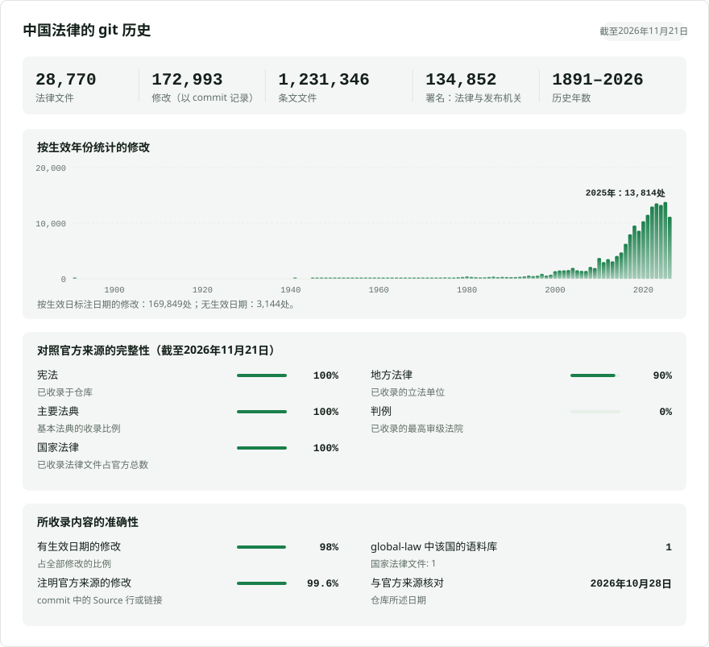

# 中国：git 中的法律历史

**简体中文** · [English](README.en.md)

<picture>
<source media="(prefers-color-scheme: dark)" srcset="data/zh/effort-dark.svg">

</picture>

以 git 历史形式呈现的中国法律：每一条为一个文件，每一个版本为一次提交，日期为该版本的施行之日，作出每一处修改的法律文件为提交的作者（author）。`git blame` 显示每一款背后的法律文件；`git log` 列出一条的全部修改；选定一个日期，即可得到当日施行的文本。

本仓库是 [lexifina/global-law](https://github.com/lexifina/global-law)（将各国法律汇为一个 git 历史）的一部分：这里是中国的国家法律，global-law 在 `china/national/acts/` 读取。

**现有内容：** 约17.3万次提交（2026年11月22日）：宪法及其五次修正（[`宪法/`](宪法/)）；全国人民代表大会及其常务委员会制定的法律，包括现行有效和已废止的法律及其各个版本、修改和废止法律的文件、法律解释和有关决定（[`法律/`](法律/)、[`修改和废止/`](修改和废止/)、[`法律解释/`](法律解释/)、[`决定/`](决定/)）；行政法规和监察法规（[`行政法规/`](行政法规/)、[`监察法规/`](监察法规/)）；部门规章（[`部门规章/`](部门规章/)）；最高人民法院和最高人民检察院的司法解释（[`司法解释/`](司法解释/)）；各省、市、县的地方性法规、地方政府规章、规范性文件和公报（[`地方/`](地方/)）；中央党内法规（[`党内法规/`](党内法规/)）；国务院及其部门的规范性文件（[`规范性文件/`](规范性文件/)）；国务院公报和全国人大常委会公报（[`公报/`](公报/)）；条约（[`条约/`](条约/)）；以及官方发布的案例（[`案例/`](案例/)）。对照官方目录：宪法100%，法律（全部版本）100%，行政法规100%，司法解释100%，现行部门规章92%，地方性法规90%，现行地方政府规章100%。[`COVERAGE.md`](COVERAGE.md) 列出每一类别的官方总数、本仓库已收录的数量以及其余尚未收录的原因；[`PLAN.md`](PLAN.md) 列出每一部分及其进度。

每部法律是 [`法律/`](法律/) 中以其中文名称命名的一个文件夹，每一条为一个文件（`法律/劳动合同法/第066条.md` 是《中华人民共和国劳动合同法》第六十六条），`目录.md` 收录其编、章的标题，`附件N.md` 收录其附件；宪法在 [`宪法/`](宪法/)，序言为 `宪法/序言.md`。2026年11月20日以前，这些文件夹以拼音命名，位于仓库顶层（`laodonghetongfa/art-066.md`）；[`data/paths.json`](data/paths.json) 列出每个旧路径对应的新路径，`git log --follow` 可跨越这次移动追踪每个文件。条文序号以现行版本为准：修改导致条文序号变动时，git 会显示文本在文件之间移动。

文本为中文，与各官方来源公布的一致。本记录不包含英文译文。

## 用 git 命令回答的问题

| 问题 | 命令 |
| --- | --- |
| 劳动合同法第六十六条的全部修改 | `git log -p --follow --word-diff -- 法律/劳动合同法/第066条.md` |
| 第六十六条的每一行由哪部法律文件写入？ | `git blame 法律/劳动合同法/第066条.md` |
| 劳动合同法的每个版本及其施行之日 | `git log --format="%h %(trailers:key=In-force,valueonly,separator=) %an" -- 法律/劳动合同法 laodonghetongfa ':!法律/劳动合同法/README.md' ':!laodonghetongfa/README.md'` |
| 2010年1月1日施行的第六十六条 | `python tools/on_date.py 2010-01-01 法律/劳动合同法 66` |

**在 git 之外**，我们还免费公开提供这一记录：

- **[向 Claude 询问中国法律](https://global-law.lexifina.com/v1/try_claude?country=china)**：打开 Claude，并已备好第一个问题。
- **[询问 ChatGPT](https://global-law.lexifina.com/v1/try_chatgpt?country=china)**：在 ChatGPT 中提出同一问题。
- **[在本网站检索中国法律](https://lexifina.com/law?country=china&q=%E5%B9%B4%E4%BC%91%E5%81%87)**：检索"年休假"，显示每一条文的文本及其各个版本，无需账户。
- **[开发者 REST API](https://global-law.lexifina.com/v1/search_law?query=%E5%B9%B4%E4%BC%91%E5%81%87&jurisdiction=china)**：以 JSON 返回同一检索，无需密钥。参见[此处的文档](https://lexifina.com/api/global-law)。

两个助手都通过免费的 Global law 连接器（MCP，`https://global-law.lexifina.com/mcp`）读取这一记录；首次使用时，对话中会给出添加该连接器的链接。可以用中文或英文提问。

**轻松自行托管。** 只需 git 和 Python，工具在您自己的计算机上运行：

```sh
git clone --depth 1 https://github.com/lexifina/global-law && cd global-law
python3 tools/countries.py add china/national/acts
python3 tools/law.py show 2026-01-01 china/national/acts/laodonghetongfa/art-066.md
```

在 Claude Code、Cursor、VS Code 或 Codex 中打开时，该克隆还会启动一个提供相同工具的本地 MCP 服务器（[MCP.md](https://github.com/lexifina/global-law/blob/main/MCP.md)）。

## 日期

每次提交的日期为该版本施行之日的正午（Asia/Shanghai），并记载于其 `In-force:` 尾注（trailer）中；除宪法外，每部法律的版本还在 `In-force-evidence:` 中说明该日期的依据：

- 通过或者修订的法律，依其本身的施行条款（本法自……起施行）；
- 由修改决定或者刑法修正案形成的版本，依其规定的施行日期（本决定自……起施行，本修正案自……起施行），通常为公布之日（自公布之日起施行）；宪法的五次修正均在同一日通过、公布和施行；
- 对《全国人大常委会公报》所载标准文本的更正（共两处，均涉及1997年刑法），采用其所更正版本的日期，`tools/on_date.py` 将其适用于该版本；
- 其他记录：依其载明的施行日期（其本身的施行条款，或来源载明的施行日期），没有的依其公布日期或发布日期；两者均未载明的记录暂不收录，绝不估计日期。在较晚版本发布之后才找到的版本，以带标记的更正（`Kind: correction`）补入，`tools/on_date.py` 将其适用于相应日期。

每一处修改都记在作出该修改的法律文件名下，名称以中国人大网所用者为准（`中华人民共和国刑法修正案（十一）（2020年）`），使用一个不可能存在的地址（`xingfa-xzan-2020@npc.gov.cn.invalid`）。记录始于法律现行汇编文本的（45部法律），全文记在最近一次修改该法律的法律文件名下；刑事诉讼法（1997年）和公司法（2018年）的最早文本、上述两处更正以及宪法2018年官方文本中的一处排印差异，记在公布者 `中国人大网 (全国人大常委会办公厅)` 名下。

## 核对方法

- `tools/check_repo.py` 将宪法的1982年版本及其现行文本与官方网页逐字节比对，并再按一个独立提取程序读取的文字和数字比对一次；还核查修正案所引述的每一处新表述均已见于该版本的文件中。两者之间的版本没有官方汇编文本：它们是适用各修正案后的结果。
- 对其他每部法律，每个来源网页的文字和数字（去除目录和标题后）必须与该法律各文件的文字和数字依次完全一致。
- `tools/test_repo.py` 核查 `git blame` 显示修改法律文件、`tools/on_date.py` 给出某一已知修改前后的文本，以及每个法律提交都有 `In-force:` 尾注。由同一组网页两次构建宪法，得到相同的头部哈希；参见 [`REPRODUCE.md`](REPRODUCE.md)。
- 历史只增不改：没有合并提交，各法律是在宪法历史之上添加的，已发布的提交不会被改写。
- [vulnerabilities/](vulnerabilities/): 本法律中可能的起草错误，由 global-law 的检测器发现并经人工核对。尚未运行。

## 未涵盖的内容

- **各类别中尚未收录的部分。** [`COVERAGE.md`](COVERAGE.md) 列出每一核心类别的缺口及其原因：尚待补入的早期版本、未载明施行日期或公布日期的记录（暂不收录，不估计日期），以及仍在限速来源排队等待的规章。
- **中国裁判文书网和人民法院案例库的裁判文书**，以及未作为官方文本公布的**军事法规**。国家法律法规数据库（flk.npc.gov.cn）的 robots.txt 禁止自动采集，因此不直接访问该网站：其 Word 文件和记录目录取自第三方镜像，每个提交均注明二者。

## 来源

| 来源 | 类型 | 历史版本 | 备注 |
| --- | --- | --- | --- |
| [中国人大网](http://www.npc.gov.cn)（全国人大常委会办公厅） | 全国人大官方网站：宪法及其修正案、法律、修改决定 | 部分有：通过或者修订时的法律及修改该法律的决定；其余仅有现行文本 | 每个版本在 `Source:` 尾注中注明其网页，汇编文本在 `Decision:` 中注明其所依据的决定 |
| 全国人大常委会公报（载于中国人大网） | 全国人大常委会公报，PDF 格式 | 公布时的文本 | 法律的标准文本（立法法）；用于民法典以及1997年刑法及其至2021年的修正案 |
| 国家法律法规数据库（flk.npc.gov.cn），其 Word 文件取自镜像 lawtext/law-flk-vol1 和 law-flk-vol2 | 法律、行政法规、监察法规、司法解释、地方性法规和有关决定 | flk 列出的每个版本 | 不直接访问 flk；每个提交注明镜像文件（`Source:`）和 flk 记录（`Flk-Id:`） |
| 国家规章库和国务院政策文件库（www.gov.cn）；国家行政法规库（xzfg.moj.gov.cn） | 部门规章和地方政府规章；国务院及其部门的文件；行政法规 | 现行文本；国家行政法规库所载的每个版本 | |
| 国务院公报（www.gov.cn/gongbao） | 国务院公报 | 公布时的文本 | 逐件收录 |
| 最高人民法院（www.court.gov.cn）及其公报 | 司法解释、指导性案例、公报案例 | 公布时的文本 | |
| 地方人大、政府及其部门；共产党员网（www.12371.cn）；外交部条约数据库 | 地方法律、规范性文件和公报；党内法规；条约 | 公布时的文本 | [`LICENSE`](LICENSE) 列出每个网站及其条款 |
| 国家法律法规数据库（flk.npc.gov.cn），其 Word 文件取自镜像 lawtext/law-flk-vol1 和 law-flk-vol2 | 法律、行政法规、监察法规、司法解释、地方性法规和有关决定 | flk 列出的每个版本 | 不直接访问 flk；每个提交注明镜像文件（`Source:`）和 flk 记录（`Flk-Id:`） |
| 国家规章库和国务院政策文件库（www.gov.cn）；国家行政法规库（xzfg.moj.gov.cn） | 部门规章和地方政府规章；国务院及其部门的文件；行政法规 | 现行文本；国家行政法规库所载的每个版本 | |
| 国务院公报（www.gov.cn/gongbao） | 国务院公报 | 公布时的文本 | 逐件收录 |
| 最高人民法院（www.court.gov.cn）及其公报 | 司法解释、指导性案例、公报案例 | 公布时的文本 | |
| 地方人大、政府及其部门；共产党员网（www.12371.cn）；外交部条约数据库 | 地方法律、规范性文件和公报；党内法规；条约 | 公布时的文本 | [`LICENSE`](LICENSE) 列出每个网站及其条款 |
| 国家法律法规数据库（flk.npc.gov.cn），其 Word 文件取自镜像 lawtext/law-flk-vol1 和 law-flk-vol2 | 法律、行政法规、监察法规、司法解释、地方性法规和有关决定 | flk 列出的每个版本 | 不直接访问 flk；每个提交注明镜像文件（`Source:`）和 flk 记录（`Flk-Id:`） |
| 国家规章库和国务院政策文件库（www.gov.cn）；国家行政法规库（xzfg.moj.gov.cn） | 部门规章和地方政府规章；国务院及其部门的文件；行政法规 | 现行文本；国家行政法规库所载的每个版本 | |
| 国务院公报（www.gov.cn/gongbao） | 国务院公报 | 公布时的文本 | 逐件收录 |
| 最高人民法院（www.court.gov.cn）及其公报 | 司法解释、指导性案例、公报案例 | 公布时的文本 | |
| 地方人大、政府及其部门；共产党员网（www.12371.cn）；外交部条约数据库 | 地方法律、规范性文件和公报；党内法规；条约 | 公布时的文本 | [`LICENSE`](LICENSE) 列出每个网站及其条款 |
| 国家法律法规数据库（flk.npc.gov.cn），其 Word 文件取自镜像 lawtext/law-flk-vol1 和 law-flk-vol2 | 法律、行政法规、监察法规、司法解释、地方性法规和有关决定 | flk 列出的每个版本 | 不直接访问 flk；每个提交注明镜像文件（`Source:`）和 flk 记录（`Flk-Id:`） |
| 国家规章库和国务院政策文件库（www.gov.cn）；国家行政法规库（xzfg.moj.gov.cn） | 部门规章和地方政府规章；国务院及其部门的文件；行政法规 | 现行文本；国家行政法规库所载的每个版本 | |
| 国务院公报（www.gov.cn/gongbao） | 国务院公报 | 公布时的文本 | 逐件收录 |
| 最高人民法院（www.court.gov.cn）及其公报 | 司法解释、指导性案例、公报案例 | 公布时的文本 | |
| 地方人大、政府及其部门；共产党员网（www.12371.cn）；外交部条约数据库 | 地方法律、规范性文件和公报；党内法规；条约 | 公布时的文本 | [`LICENSE`](LICENSE) 列出每个网站及其条款 |
| 国家法律法规数据库（flk.npc.gov.cn），其 Word 文件取自镜像 lawtext/law-flk-vol1 和 law-flk-vol2 | 法律、行政法规、监察法规、司法解释、地方性法规和有关决定 | flk 列出的每个版本 | 不直接访问 flk；每个提交注明镜像文件（`Source:`）和 flk 记录（`Flk-Id:`） |
| 国家规章库和国务院政策文件库（www.gov.cn）；国家行政法规库（xzfg.moj.gov.cn） | 部门规章和地方政府规章；国务院及其部门的文件；行政法规 | 现行文本；国家行政法规库所载的每个版本 | |
| 国务院公报（www.gov.cn/gongbao） | 国务院公报 | 公布时的文本 | 逐件收录 |
| 最高人民法院（www.court.gov.cn）及其公报 | 司法解释、指导性案例、公报案例 | 公布时的文本 | |
| 地方人大、政府及其部门；共产党员网（www.12371.cn）；外交部条约数据库 | 地方法律、规范性文件和公报；党内法规；条约 | 公布时的文本 | [`LICENSE`](LICENSE) 列出每个网站及其条款 |

## 许可

参见 [`LICENSE`](LICENSE)。在中国，国家机关的法律、决议、决定及其官方正式译文不受著作权法保护（著作权法第五条）；中国人大网未就这些网页声明任何再利用条款。Lexifina 所做的一切（以提交形式呈现的历史、提交说明、文件夹结构、数据、工具和文档）均依 CC0 1.0 贡献于公有领域；[`LICENSE`](LICENSE) 列出每个来源及其自身的条款和查阅日期。

没有任何人工智能模型编写或修改法律文本，构建历史时也不运行任何人工智能模型；一个人工智能模型研究了各来源，并编写了脚本和文档（参见 [`REPRODUCE.md`](REPRODUCE.md)）。

本文为英文版（[README.en.md](README.en.md)）的译文；如有不一致，以英文版为准。

## 可视化

- [visualisations/](visualisations/): 根据本仓库绘制的图表。尚未绘制。

## 更多信息

来自 [lexifina/global-law](https://github.com/lexifina/global-law) 仓库（英文页面）：

- [FEATURES.md](https://github.com/lexifina/global-law/blob/main/FEATURES.md): 全部功能，以及每个语料库须支持的内容（`git blame`、`law.py`、MCP 工具）
- [FAQ.md](https://github.com/lexifina/global-law/blob/main/FAQ.md): 常见问题 · [CONTRIBUTING.md](https://github.com/lexifina/global-law/blob/main/CONTRIBUTING.md): 提出修改建议 · [MCP.md](https://github.com/lexifina/global-law/blob/main/MCP.md): MCP 服务器 · [REPRODUCE.md](https://github.com/lexifina/global-law/blob/main/REPRODUCE.md): 构建方法 · [CHANGELOG.md](https://github.com/lexifina/global-law/blob/main/CHANGELOG.md)
- [FRESHNESS.md](https://github.com/lexifina/global-law/blob/main/FRESHNESS.md): 各语料库的更新程度 · [监测](https://github.com/lexifina/global-law/tree/main/monitoring): 更新是否在正常运行 · [WATCHING.md](https://github.com/lexifina/global-law/blob/main/WATCHING.md): 如何监视每个官方来源的变化
- [performance/](https://github.com/lexifina/global-law/tree/main/performance): 工具速度的实测结果
- [visualisations/](https://github.com/lexifina/global-law/tree/main/visualisations): 贯通全球法律的图表与关联
- [漏洞](https://github.com/lexifina/global-law/tree/main/vulnerabilities): 已公布法律文本中的错误
